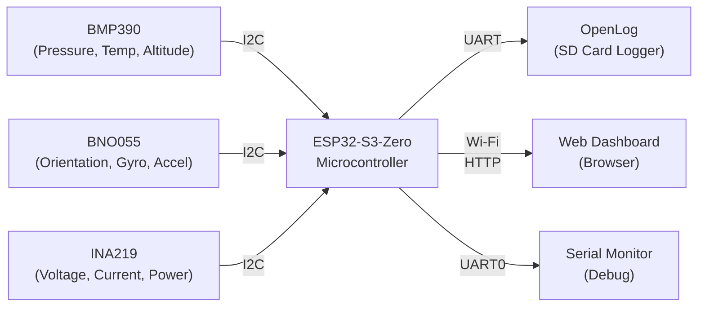
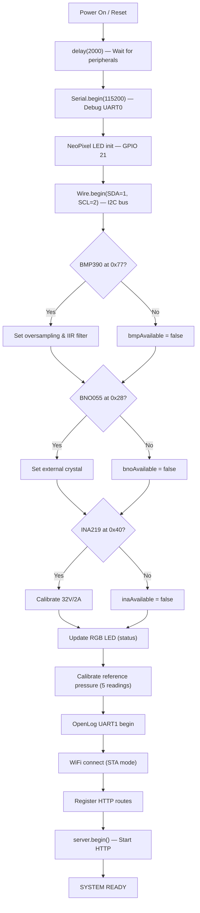
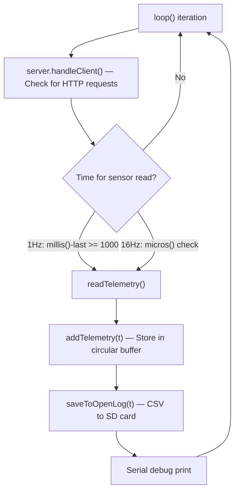

# 🎓 Microprocessor & Interfacing — CanSat Project Viva Preparation Guide

> **Project**: ESP32-S3 based CanSat Telemetry System  
> **Course**: Microprocessor and Interfacing (MI)  
> **Student**: Anurag Pillai — Nirma University, Semester 5

---

## 📋 Table of Contents

1. [Project Overview — What & Why](#1-project-overview)
2. [The Microcontroller — ESP32-S3](#2-the-microcontroller--esp32-s3)
3. [Communication Protocols Used](#3-communication-protocols)
4. [Sensor Deep-Dives (Hardware + Interfacing)](#4-sensor-deep-dives)
5. [Pin Mapping & Wiring Diagram](#5-pin-mapping--wiring)
6. [Code Architecture — setup() and loop()](#6-code-architecture)
7. [Timing & Scheduling — 1 Hz vs 16 Hz](#7-timing--scheduling)
8. [Data Flow: Sensor → MCU → Wi-Fi → Browser](#8-data-flow)
9. [Calibration — What, Why, How](#9-calibration)
10. [Status LED — NeoPixel Diagnostic](#10-status-led)
11. [Likely Viva Questions & Model Answers](#11-viva-qa)

---

## 1. Project Overview

### What is a CanSat?
A **CanSat** (Can-Satellite) is a miniature satellite built inside a soda-can-sized container. It simulates a real satellite mission: it is launched (usually via a rocket or drone), descends under a parachute, and collects telemetry data during its flight — pressure, altitude, orientation, temperature, and battery health.

### What does YOUR project do?



Your system:
1. **Reads** 3 sensors (BMP390, BNO055, INA219) over **I2C**
2. **Logs** telemetry to an SD card via **UART** (OpenLog)
3. **Serves** live telemetry as a **JSON REST API** over **Wi-Fi**
4. **Displays** real-time data on a **web dashboard** in a browser
5. **Indicates** system health via an **RGB NeoPixel LED**

---

## 2. The Microcontroller — ESP32-S3

### Why ESP32-S3 (not ESP32 or Arduino)?

| Feature | Arduino Uno | ESP32 | ESP32-S3 (yours) |
|---|---|---|---|
| CPU | 8-bit AVR, 16 MHz | Dual-core Xtensa LX6, 240 MHz | Dual-core Xtensa LX7, 240 MHz |
| RAM | 2 KB SRAM | 520 KB SRAM | 512 KB SRAM + 8 MB PSRAM |
| Wi-Fi | ❌ None | ✅ 2.4 GHz | ✅ 2.4 GHz |
| Bluetooth | ❌ None | ✅ BLE 4.2 | ✅ BLE 5.0 |
| USB | via FTDI/CH340 | via UART-USB bridge | Native USB (USB-OTG) |
| I2C buses | 1 | 2 | 2 |
| UART ports | 1 (shared with USB) | 3 | 3 |
| ADC bits | 10-bit | 12-bit | 12-bit |
| Price | ~₹350 | ~₹400 | ~₹500 |

### Key MI Concepts in the ESP32-S3

#### Harvard Architecture (Modified)
The ESP32-S3 uses a **modified Harvard architecture** — separate buses for instruction and data memory, but a shared address space. This allows simultaneous instruction fetch and data access, increasing throughput.

#### 32-bit RISC Processor
- **Word size**: 32 bits
- **ISA**: Xtensa LX7 (a RISC-like instruction set by Cadence/Tensilica)
- **Pipeline**: 5-stage pipeline (Fetch → Decode → Execute → Memory → Write-back)

#### Clock Speed
- **240 MHz** clock → cycle time = **4.17 ns**
- This is ~15× faster than an Arduino Uno (16 MHz)

#### Memory Map
```
┌─────────────────────────┐ 0x600C_0000
│  Peripheral Registers   │  ← I2C, UART, SPI, GPIO registers
├─────────────────────────┤ 0x3FC8_0000
│  Internal SRAM (512 KB) │  ← Stack, heap, global variables
├─────────────────────────┤ 0x3C00_0000
│  External PSRAM (8 MB)  │  ← Large buffers (if enabled)
├─────────────────────────┤ 0x4200_0000
│  Flash (code + consts)  │  ← Your .ino compiled code
└─────────────────────────┘
```

#### GPIO (General Purpose Input/Output)
- ESP32-S3-Zero has GPIOs numbered 0–21
- Each GPIO can be configured as **input**, **output**, or **alternate function** (I2C, UART, SPI, PWM)
- Configuration is done through **GPIO Matrix** — a flexible mux that can route any peripheral signal to almost any pin

> [!IMPORTANT]
> **Viva point**: "The ESP32-S3 uses a GPIO matrix that allows software-defined pin mapping. Unlike ATmega328 (Arduino), where I2C is fixed to pins A4/A5, the ESP32-S3 can assign I2C SDA/SCL to *any* GPIO pins."

---

## 3. Communication Protocols

Your project uses **3 communication protocols** — this is the most MI-heavy part of the project.

### 3.1 I2C (Inter-Integrated Circuit)

> Used for: **BMP390, BNO055, INA219** — all 3 sensors

#### What is I2C?
A **synchronous, half-duplex, multi-master, multi-slave** serial bus that uses only **2 wires**:

| Line | Name | Function |
|---|---|---|
| **SDA** | Serial Data | Bidirectional data line |
| **SCL** | Serial Clock | Clock (always driven by master) |

```
    ┌──────────┐     SDA (GPIO 1)     ┌──────────┐
    │          │◄──────────────────────│          │
    │ ESP32-S3 │                       │  BMP390  │ (Address: 0x77)
    │ (Master) │     SCL (GPIO 2)      │  (Slave) │
    │          │──────────────────────►│          │
    └──────────┘          │            └──────────┘
                          │
                    ┌─────┴─────┐      ┌──────────┐
                    │           │      │  BNO055  │ (Address: 0x28)
                    │  Shared   │◄────►│  (Slave) │
                    │   Bus     │      └──────────┘
                    │           │
                    │           │      ┌──────────┐
                    │           │◄────►│  INA219  │ (Address: 0x40)
                    └───────────┘      └──────────┘
```

#### How I2C Works — Frame Format

```
START → [7-bit Address][R/W] → ACK → [8-bit Data] → ACK → ... → STOP
  │          │            │      │         │           │           │
  ▼          ▼            ▼      ▼         ▼           ▼           ▼
SDA goes   Master       0=Write Slave    Master or    Slave      SDA goes
LOW while  sends        1=Read  pulls    Slave sends  pulls      HIGH while
SCL HIGH   address             SDA LOW   8 data bits  SDA LOW    SCL HIGH
```

#### I2C Addressing in YOUR Code

```cpp
// In your code (1Hz-tabular.ino):
Wire.begin(SDA_PIN, SCL_PIN);  // SDA=GPIO1, SCL=GPIO2

bmp.begin_I2C(0x77);           // BMP390 at address 0x77
// BNO055 at address 0x28 (set in constructor)
// INA219 at address 0x40 (set in constructor)
```

- Each device has a **unique 7-bit address** on the same bus
- `0x77` = `0b1110111` → BMP390
- `0x28` = `0b0101000` → BNO055
- `0x40` = `0b1000000` → INA219

#### I2C Speed Modes

| Mode | Speed | Used in your code? |
|---|---|---|
| Standard Mode | 100 kHz | ✅ `1Hz-tabular` (default) |
| Fast Mode | 400 kHz | ✅ `16Hz-api` (`Wire.setClock(400000)`) |
| Fast Mode Plus | 1 MHz | ❌ |
| High Speed | 3.4 MHz | ❌ |

> [!TIP]
> **Why 400 kHz in 16 Hz version?** At 16 Hz, you read sensors every 62.5 ms. At 100 kHz I2C, each sensor read takes ~2-5 ms. With 3 sensors, that's 6-15 ms per cycle — still fine. But at 400 kHz, reads take ~0.5-1.5 ms each, giving more headroom for the HTTP server to respond between sensor reads.

#### Pull-up Resistors
I2C requires **pull-up resistors** on both SDA and SCL lines (typically 4.7 kΩ to 10 kΩ). Most breakout boards (like Adafruit's) have these built-in.

---

### 3.2 UART (Universal Asynchronous Receiver/Transmitter)

> Used for: **OpenLog SD Card Logger** and **Serial Monitor (debug)**

#### What is UART?
An **asynchronous, full-duplex, point-to-point** serial protocol. Unlike I2C, there is **no clock line** — both devices must agree on a **baud rate** beforehand.

| Line | Function |
|---|---|
| **TX** (Transmit) | Data out from sender |
| **RX** (Receive) | Data in to receiver |

```
ESP32-S3                          OpenLog
┌──────────┐                     ┌──────────┐
│    TX ────┼────────────────────►│ RX       │
│   (GPIO5) │                     │          │
│    RX ────┼◄────────────────────│ TX       │
│  (GPIO13) │                     │          │
│    GND ───┼─────────────────────│ GND      │
└──────────┘                     └──────────┘
```

#### UART Frame Format

```
IDLE ─── START ─── D0 D1 D2 D3 D4 D5 D6 D7 ─── STOP ─── IDLE
 (HIGH)   (LOW)          (8 data bits)          (HIGH)    (HIGH)
```

- **Start bit**: 1 bit (always LOW) — signals beginning of frame
- **Data bits**: 8 bits (LSB first)
- **Parity bit**: None in your config (`SERIAL_8N1` = 8 data, No parity, 1 stop)
- **Stop bit**: 1 bit (always HIGH)
- Total: **10 bits per byte** (8 data + 1 start + 1 stop)

#### Baud Rates in YOUR Code

| UART Channel | Baud Rate | Connected To | Purpose |
|---|---|---|---|
| UART0 | 115200 | USB Serial Monitor | Debug output |
| UART1 | 9600 (1Hz ver.) / 115200 (16Hz ver.) | OpenLog | SD card logging |

```cpp
// Serial Monitor (UART0)
Serial.begin(115200);

// OpenLog (UART1)
OpenLog.begin(9600, SERIAL_8N1, OPENLOG_RX, OPENLOG_TX);
// 16Hz version uses 115200 for faster logging
```

> [!IMPORTANT]
> **Viva point**: "UART is asynchronous — no clock line. Both devices must be pre-configured to the same baud rate. A mismatch (e.g., ESP sends at 115200 but OpenLog expects 9600) results in **garbled data**."

#### Baud Rate Calculation
- Baud rate = **symbols per second**
- At 115200 baud with 10 bits/byte: **11,520 bytes/second** = ~11.25 KB/s
- At 9600 baud: **960 bytes/second** = ~0.94 KB/s

---

### 3.3 SPI-like — NeoPixel (WS2812B)

> Used for: **Onboard RGB LED** (status indicator)

The WS2812B NeoPixel uses a **single-wire, timing-based protocol** — not strictly SPI, but it's a one-wire serial protocol:

- **Logic 0**: HIGH for 0.4 µs, LOW for 0.85 µs
- **Logic 1**: HIGH for 0.8 µs, LOW for 0.45 µs
- **Reset**: LOW for > 50 µs

Each LED receives **24 bits** (8 bits Green + 8 bits Red + 8 bits Blue) in **GRB order**.

```cpp
// In your code:
Adafruit_NeoPixel statusLED(LED_COUNT, LED_PIN, NEO_GRB + NEO_KHZ800);
//                            1 LED      GPIO21    GRB order, 800 kHz
```

---

### 3.4 Wi-Fi + HTTP (Network Layer)

> Used for: **Serving telemetry API to the web dashboard**

```
ESP32-S3 connects to router → Gets IP address via DHCP → Starts HTTP server on port 80
```

```cpp
WiFi.mode(WIFI_STA);              // Station mode (client to router)
WiFi.begin(WIFI_SSID, WIFI_PASSWORD);

server.on("/api/telemetry", handleTelemetryAPI);  // Register route
server.on("/api/status", handleStatusAPI);
server.begin();                    // Start listening on port 80
```

**In the `loop()`**, `server.handleClient()` is called every iteration to process incoming HTTP requests — this is a **polling-based** approach (non-blocking).

---

## 4. Sensor Deep-Dives

### 4.1 BMP390 — Barometric Pressure & Temperature Sensor

| Parameter | Value |
|---|---|
| **Manufacturer** | Bosch Sensortec |
| **Interface** | I2C (address `0x77`) or SPI |
| **Pressure Range** | 300 – 1250 hPa |
| **Pressure Resolution** | ±0.03 hPa (≈ ±0.25 m altitude) |
| **Temperature Range** | -40°C to +85°C |
| **Supply Voltage** | 1.7V – 3.6V |

#### How it measures pressure
The BMP390 uses a **MEMS piezoresistive** pressure sensor:
- A thin silicon diaphragm deflects under atmospheric pressure
- Piezoresistors embedded in the diaphragm change resistance proportionally
- A **Wheatstone bridge** circuit converts resistance change → voltage
- An internal **24-bit ADC** digitizes this voltage
- The onboard **DSP** applies calibration coefficients

#### Oversampling (in your code)
```cpp
bmp.setTemperatureOversampling(BMP3_OVERSAMPLING_8X);  // 1Hz version
bmp.setPressureOversampling(BMP3_OVERSAMPLING_4X);
bmp.setIIRFilterCoeff(BMP3_IIR_FILTER_COEFF_3);
```

- **Oversampling**: Take multiple ADC readings and average them → reduces noise
- **8X oversampling** for temperature: takes 8 readings, averages → smoother
- **4X oversampling** for pressure: 4 readings averaged
- **IIR filter (coeff=3)**: Infinite Impulse Response low-pass filter — smooths out short-term fluctuations (e.g., wind gusts)

> [!NOTE]
> The 16 Hz version uses **2X** temperature oversampling (instead of 8X) to reduce conversion time and achieve 16 readings/second.

#### Altitude Calculation
```cpp
t.altitude = bmp.readAltitude(referencePressure);
```

Uses the **Barometric/Hypsometric formula**:

$$altitude = 44330 \times \left(1 - \left(\frac{P}{P_0}\right)^{0.1903}\right)$$

Where:
- $P$ = measured pressure (hPa)
- $P_0$ = reference pressure at ground level (your `referencePressure`)
- 44330 is a constant derived from the standard atmosphere model

---

### 4.2 BNO055 — 9-DOF IMU (Inertial Measurement Unit)

| Parameter | Value |
|---|---|
| **Manufacturer** | Bosch Sensortec |
| **Interface** | I2C (address `0x28`) |
| **Contains** | 3-axis accelerometer + 3-axis gyroscope + 3-axis magnetometer |
| **Built-in** | ARM Cortex-M0 processor for sensor fusion |
| **Supply Voltage** | 2.4V – 3.6V |

#### What is 9-DOF?
**9 Degrees of Freedom**: 3 axes each for acceleration, angular velocity, and magnetic field.

#### The three internal sensors:

| Sensor | Measures | Unit | Used in your code as |
|---|---|---|---|
| **Accelerometer** | Linear acceleration | m/s² | `accelX`, `accelY`, `accelZ` |
| **Gyroscope** | Angular velocity | rad/s | `gyroX`, `gyroY`, `gyroZ` |
| **Magnetometer** | Magnetic field | µT | (used internally for fusion) |

#### Sensor Fusion — Euler Angles
The BNO055 has an **onboard ARM Cortex-M0** processor that runs a **sensor fusion algorithm** (Bosch's proprietary BSX). It combines all 9 axes to compute:

- **Yaw** (Heading): Rotation around Z-axis (0°–360°)
- **Pitch**: Rotation around Y-axis (-180° to +180°)
- **Roll**: Rotation around X-axis (-90° to +90°)

```cpp
bno.getEvent(&orientationData, Adafruit_BNO055::VECTOR_EULER);

t.yaw   = orientationData.orientation.x;  // Heading (0-360°)
t.pitch = orientationData.orientation.y;  // Pitch
t.roll  = orientationData.orientation.z;  // Roll
```

#### External Crystal
```cpp
bno.setExtCrystalUse(true);
```
Uses the **32.768 kHz crystal on the breakout board** (instead of the BNO055's internal RC oscillator) for more accurate timing → better sensor fusion.

> [!IMPORTANT]
> **Viva point**: "The BNO055 is unique because it does sensor fusion *onboard* — you don't need to implement Kalman filters or complementary filters in your ESP32 code. The ARM Cortex-M0 inside the BNO055 handles this, giving you ready-to-use Euler angles."

---

### 4.3 INA219 — Current/Voltage/Power Monitor

| Parameter | Value |
|---|---|
| **Manufacturer** | Texas Instruments |
| **Interface** | I2C (address `0x40`) |
| **Measures** | Bus voltage, shunt current, power |
| **Voltage Range** | 0 – 26V (bus), ±320 mV (shunt) |
| **Resolution** | 12-bit ADC |
| **Shunt Resistor** | 0.1 Ω (on breakout board) |

#### How it works
```
Battery ──►[─── Shunt Resistor (0.1Ω) ───]──► Load (ESP32 + sensors)
                      │                │
                      ▼                ▼
                  INA219 measures voltage drop across shunt
                  V_shunt = I × R_shunt
                  I = V_shunt / 0.1Ω
```

- **Bus Voltage**: Measured directly from the bus (battery voltage)
- **Shunt Voltage**: Tiny voltage drop across the 0.1 Ω shunt resistor
- **Current**: Calculated as `I = V_shunt / R_shunt`
- **Power**: `P = V_bus × I`

```cpp
ina219.setCalibration_32V_2A();  // Calibrate for 0-32V, 0-2A range

t.voltage = ina219.getBusVoltage_V();   // Battery voltage
t.current = ina219.getCurrent_mA();     // Current draw in mA
t.power   = ina219.getPower_mW();       // Power consumption in mW
```

> [!TIP]
> **Why monitor battery?** In a CanSat mission, battery life is critical. The INA219 lets you monitor real-time power consumption and predict remaining flight time.

---

## 5. Pin Mapping & Wiring

### ESP32-S3-Zero Pin Assignment

```
                    ┌───────────────────┐
                    │   ESP32-S3-Zero   │
                    │                   │
    BMP390 SDA ◄───►│ GPIO 1  (SDA)     │
    BNO055 SDA ◄───►│                   │
    INA219 SDA ◄───►│                   │
                    │                   │
    BMP390 SCL ◄────│ GPIO 2  (SCL)     │
    BNO055 SCL ◄────│                   │
    INA219 SCL ◄────│                   │
                    │                   │
    OpenLog TX ◄────│ GPIO 5  (UART1 TX)│
    OpenLog RX ────►│ GPIO 13 (UART1 RX)│
                    │                   │
    NeoPixel LED ◄──│ GPIO 21 (LED)     │
                    │                   │
    USB Debug ◄────►│ UART0 (USB-C)     │
                    └───────────────────┘
```

### I2C Bus Configuration

| Device | Address | Pull-ups | Notes |
|---|---|---|---|
| BMP390 | `0x77` | On breakout | SDO pin HIGH = 0x77, LOW = 0x76 |
| BNO055 | `0x28` | On breakout | COM3 pin LOW = 0x28, HIGH = 0x29 |
| INA219 | `0x40` | On breakout | A0=GND, A1=GND → 0x40 |

> [!WARNING]
> All three devices share the **same** I2C bus (same SDA/SCL lines). If any device has a **shorted** SDA or SCL line, the entire bus will hang. The code handles this gracefully by checking `bmpAvailable`, `bnoAvailable`, `inaAvailable` flags.

---

## 6. Code Architecture

### `setup()` — Runs once at power-on



### `loop()` — Runs forever



> [!NOTE]
> **Key MI concept**: The `loop()` uses **polling** (checking `millis()` / `micros()`) instead of hardware **interrupts**. This is simpler but less power-efficient. A more advanced approach would use **timer interrupts** to trigger sensor reads at precise intervals.

---

## 7. Timing & Scheduling

### 1 Hz Version ([1Hz-tabular.ino](file:///d:/One%20Drive/OneDrive%20-%20nirmauni.ac.in/Nirma%20University/Semester%205/Innovative%20Assignment/MI_FSD/ESP32-S3-Zero%20Codes/1Hz-tabular/1Hz-tabular.ino))

```cpp
static unsigned long lastTelemetry = 0;
if (millis() - lastTelemetry >= 1000) {  // 1000 ms = 1 Hz
    lastTelemetry = millis();
    // read + store + log
}
```

- Uses `millis()` → millisecond resolution
- Simple and sufficient for 1 reading/second
- Stores **20 packets** in a circular buffer (history)

### 16 Hz Version ([16Hz-api.ino](file:///d:/One%20Drive/OneDrive%20-%20nirmauni.ac.in/Nirma%20University/Semester%205/Innovative%20Assignment/MI_FSD/ESP32-S3-Zero%20Codes/16Hz-api/16Hz-api.ino))

```cpp
#define SENSOR_INTERVAL_US 62500UL  // 1/16 s = 62,500 µs

uint32_t nextSensorTime = micros();

// In loop():
if ((int32_t)(micros() - nextSensorTime) >= 0) {
    nextSensorTime += SENSOR_INTERVAL_US;
    acquireTelemetry();
    
    // Log only every 8th packet (2 Hz to SD card)
    if (packetCount % LOG_EVERY_N_PACKETS == 0) {
        logTelemetry(latestTelemetry);
    }
}
```

- Uses `micros()` → **microsecond** resolution (needed for 62.5 ms precision)
- **Additive timing** (`nextSensorTime += interval`) instead of resetting → prevents drift
- Sensors at 16 Hz, but SD card logging at only 2 Hz (every 8th packet) — because UART to OpenLog is the bottleneck

> [!IMPORTANT]
> **Viva point**: "The `(int32_t)` cast handles **unsigned integer overflow** of `micros()`. Without it, when `micros()` wraps around at ~71 minutes (2³² µs), the subtraction would give a huge positive number. The signed cast ensures correct comparison even after overflow."

---

## 8. Data Flow

```
┌─────────────────────────────────────────────────────────────────────┐
│                        SENSOR LAYER                                 │
│  BMP390 ──► pressure, temperature, altitude                         │
│  BNO055 ──► accel(xyz), gyro(xyz), orientation(pitch/roll/yaw)      │
│  INA219 ──► voltage, current, power                                 │
│             ↓ (I2C @ 100/400 kHz)                                   │
├─────────────────────────────────────────────────────────────────────┤
│                     PROCESSING LAYER (ESP32-S3)                     │
│  readTelemetry() → struct Telemetry { 17 fields }                   │
│                                                                     │
│  ┌──────────────┐  ┌──────────────┐  ┌──────────────┐              │
│  │ Circular     │  │ OpenLog      │  │ HTTP Server  │              │
│  │ Buffer (20)  │  │ CSV Logger   │  │ JSON API     │              │
│  │ (RAM)        │  │ (SD Card)    │  │ (Wi-Fi)      │              │
│  └──────────────┘  └──────────────┘  └──────────────┘              │
│       ↓                   ↓                  ↓                      │
├─────────────────────────────────────────────────────────────────────┤
│                        OUTPUT LAYER                                 │
│  Web Dashboard          SD Card File         Serial Monitor         │
│  (browser fetch)        (CSV file)           (USB debug)            │
└─────────────────────────────────────────────────────────────────────┘
```

### JSON API Response Format (16Hz version)
```json
{
  "p": 42,           // packet number
  "pr": 1013.25,     // pressure (hPa)
  "a": 5.32,         // altitude (m)
  "v": 0.15,         // velocity (m/s)
  "x": 12.50,        // orientation X (heading)
  "y": -3.20,        // orientation Y (pitch)
  "z": 1.10,         // orientation Z (roll)
  "bv": 3.712        // battery voltage (V)
}
```

---

## 9. Calibration

### Pressure Calibration (BMP390)
```cpp
void calibrateReferencePressure() {
    for (int i = 0; i < 5; i++) {
        pressure = bmp.pressure / 100.0;
        if (i == 4) {
            referencePressure = pressure;  // 5th reading = reference
        }
        delay(200);
    }
}
```

**Why 5 readings?** The BMP390 needs a few readings to stabilize its internal IIR filter. The first few readings may be noisy. The 5th reading is more stable and is used as the **ground-level reference** for altitude calculation.

### Orientation Calibration (BNO055) — 16Hz-api-reset-calibrate version

```cpp
// Store current orientation as "zero"
bnoReferenceX = orientation.orientation.x;
bnoReferenceY = orientation.orientation.y;
bnoReferenceZ = orientation.orientation.z;

// During readings, subtract reference:
t.orientationX = rawX - bnoReferenceX;
```

This creates a **software-defined zero point** — wherever the CanSat is pointing when you calibrate becomes (0, 0, 0).

---

## 10. Status LED

The onboard NeoPixel LED provides **visual diagnostics**:

| LED Color | Meaning | Condition |
|---|---|---|
| 🔴 **RED** | Critical failure | Both BMP390 and BNO055 missing |
| 🟠 **ORANGE** | Partial failure | BNO055 works, BMP390 missing |
| 🟡 **YELLOW** | Partial failure | BMP390 works, BNO055 missing |
| 🟢 **GREEN** | All OK | Both BMP390 and BNO055 detected |

> The INA219 status is not included in the LED logic because it's not mission-critical — it only monitors battery, not flight data.

---

## 11. Likely Viva Questions & Model Answers

### Category: Microprocessor Basics

**Q1: What microcontroller are you using? What is its architecture?**
> "We are using the **ESP32-S3** by Espressif Systems. It has a **dual-core Xtensa LX7 processor** running at **240 MHz**, uses a **modified Harvard architecture** with separate instruction and data buses. It's a **32-bit RISC** processor with a 5-stage pipeline. It has 512 KB SRAM, supports Wi-Fi 802.11 b/g/n and BLE 5.0, and has native USB support."

**Q2: What is the difference between Harvard and Von Neumann architecture?**
> "In **Von Neumann architecture**, instructions and data share the same memory and bus — only one can be accessed at a time, causing a bottleneck. In **Harvard architecture**, there are separate memories and buses for instructions and data, allowing simultaneous access. The ESP32-S3 uses a **modified Harvard** — logically separate but with a shared address space for flexibility."

**Q3: Why did you choose ESP32-S3 over Arduino?**
> "Arduino Uno has an 8-bit processor at 16 MHz with only 2 KB RAM and no Wi-Fi. Our project needs to read 3 I2C sensors at up to 16 Hz, run an HTTP web server, log to SD card via UART, and serve a web dashboard — all simultaneously. The ESP32-S3's dual-core 240 MHz processor, 512 KB RAM, built-in Wi-Fi, and multiple UART/I2C buses make this possible."

---

### Category: Communication Protocols

**Q4: Explain the I2C protocol. How many devices can it support?**
> "I2C is a **synchronous, half-duplex, serial protocol** using two wires — SDA (data) and SCL (clock). The master generates the clock and initiates communication. Each slave has a unique **7-bit address** (supporting up to **127 devices** theoretically, but practically limited by bus capacitance and address conflicts). Communication starts with a START condition, then the master sends the slave address + R/W bit, waits for an ACK, then sends/receives data bytes, and ends with a STOP condition."

**Q5: How many I2C devices are on your bus? What are their addresses?**
> "Three devices: **BMP390** at `0x77` (barometric pressure), **BNO055** at `0x28` (IMU), and **INA219** at `0x40` (power monitor). All share the same SDA (GPIO 1) and SCL (GPIO 2) lines. They can coexist because each has a unique address."

**Q6: What is the difference between I2C and UART?**
> | Feature | I2C | UART |
> |---|---|---|
> | Synchronization | Synchronous (has clock) | Asynchronous (no clock) |
> | Wires | 2 (SDA + SCL) | 2 (TX + RX) |
> | Direction | Half-duplex | Full-duplex |
> | Topology | Multi-slave bus | Point-to-point |
> | Speed | 100/400 kHz / 1 MHz | Custom (9600, 115200, etc.) |
> | Addressing | 7-bit slave address | None (direct connection) |

**Q7: What happens if two I2C devices have the same address?**
> "Both devices would respond simultaneously to the master's address, causing **bus contention** on the SDA line — data would be corrupted and communication would fail. This is called an **address collision**. To resolve it, most I2C devices have configurable address pins (e.g., the INA219 has A0 and A1 pins that can be tied HIGH or LOW to select from 4 different addresses)."

**Q8: What is UART? Why does OpenLog use UART instead of I2C?**
> "UART is an asynchronous serial protocol — no clock line, both sides must agree on a baud rate. OpenLog uses UART because SD card writing can take variable time (wear leveling, sector allocation). UART's **asynchronous, buffered** nature handles this better than I2C, where the master controls timing. Also, UART is full-duplex and point-to-point, which is simpler for a dedicated logging device."

**Q9: What does `SERIAL_8N1` mean?**
> "It specifies the UART frame format: **8** data bits, **N**o parity bit, **1** stop bit. This means each frame is 10 bits total (1 start + 8 data + 1 stop), and there's no error detection via parity."

---

### Category: Sensors & Interfacing

**Q10: How does the BMP390 measure altitude?**
> "It measures atmospheric **pressure**, which decreases with altitude. Using the **barometric formula** — `altitude = 44330 × (1 - (P/P₀)^0.1903)` — where P is the current pressure and P₀ is the reference pressure at ground level. We calibrate P₀ at startup by taking 5 pressure readings and using the 5th as reference."

**Q11: What is oversampling? Why do you use it?**
> "Oversampling means taking **multiple ADC readings** and averaging them. If you oversample 4X, you take 4 readings and average them into one. This **reduces random noise** by a factor of √4 = 2. The trade-off is increased conversion time. We use 8X temperature and 4X pressure oversampling for accuracy in the 1 Hz version, and 2X/4X in the 16 Hz version for speed."

**Q12: What is an IIR filter? Why is it used in the BMP390?**
> "IIR stands for **Infinite Impulse Response** — it's a digital low-pass filter. `output = (1-α) × previous_output + α × new_reading`. The BMP390's IIR filter smooths out sudden pressure fluctuations (e.g., from wind gusts or door openings) while preserving the true altitude trend. Coefficient 3 means it moderately dampens rapid changes."

**Q13: What does the BNO055's sensor fusion do? Why is it special?**
> "The BNO055 has an **ARM Cortex-M0 coprocessor** onboard that runs a sensor fusion algorithm. It combines data from its accelerometer, gyroscope, and magnetometer to compute **absolute orientation** (Euler angles: pitch, roll, yaw). Without fusion, gyroscope data drifts over time and accelerometers are noisy. The fusion corrects both — gyro for short-term accuracy, accelerometer/magnetometer for long-term stability. This is special because most IMUs require you to implement fusion (Kalman filter, etc.) in your own code."

**Q14: How does the INA219 measure current?**
> "It measures the **voltage drop across a known shunt resistor** (0.1 Ω) in series with the load. Using Ohm's Law: `I = V_shunt / R_shunt`. The INA219 has a precision 12-bit ADC that measures the shunt voltage (range ±320 mV) and bus voltage separately, then computes current and power internally."

---

### Category: Code & System Design

**Q15: What is the role of `setup()` and `loop()` in Arduino?**
> "`setup()` runs **once** after power-on or reset — it initializes peripherals (I2C, UART, Wi-Fi, sensors). `loop()` runs **continuously forever** after `setup()` completes — it's the main program loop that reads sensors, logs data, and handles HTTP requests. This is similar to embedded `main()` with an infinite `while(1)` loop."

**Q16: Why do you use `millis()` in the 1 Hz version but `micros()` in the 16 Hz version?**
> "`millis()` returns time in milliseconds — good for 1-second (1000 ms) intervals. But at 16 Hz, the interval is 62.5 ms — `millis()` has ±1 ms jitter which is ~1.6% error. `micros()` has microsecond resolution, so 62,500 µs intervals are much more precise. Also, the 16 Hz version uses **additive timing** (`nextTime += interval`) rather than resetting, which prevents cumulative drift."

**Q17: What is CORS and why is it in the 16Hz-api-reset-calibrate version?**
> "CORS (Cross-Origin Resource Sharing) allows the web frontend (running on `localhost:5173` during development) to make API requests to the ESP32 (running on a different IP like `192.168.1.x`). Without CORS headers, the browser would block these **cross-origin** requests for security. The header `Access-Control-Allow-Origin: *` permits requests from any origin."

**Q18: What is the circular buffer in the 1 Hz version?**
> "A fixed-size array of 20 `Telemetry` structs. When a new packet arrives, all existing packets shift down by one position, and the new packet is inserted at index 0. When the array is full, the oldest packet (at index 19) is discarded. This keeps the **last 20 seconds** of telemetry in RAM for the web dashboard to display."

**Q19: How does the web dashboard get data?**
> "The ESP32 runs an HTTP server. The dashboard (served as an HTML page from the ESP32 itself in the 1 Hz version, or from a separate Vite dev server in the 16 Hz version) uses JavaScript `fetch()` to call `/api/telemetry` (1 Hz) or `/api/live` (16 Hz) at regular intervals. The response is JSON, which is parsed and rendered into an HTML table or chart."

---

### Category: Practical / Hardware

**Q20: What happens if a sensor is disconnected mid-flight?**
> "The code checks `bmpAvailable`, `bnoAvailable`, `inaAvailable` flags before every sensor read. If a sensor was detected at startup but fails during operation, `bmp.performReading()` or `bno.getEvent()` will fail, and the telemetry values for that sensor will be **zero**. The RGB LED color reflects the initial detection status. The system is **fault-tolerant** — it continues operating with whatever sensors are available."

**Q21: Why 9600 baud for OpenLog in the 1 Hz version but 115200 in the 16 Hz version?**
> "At 1 Hz, each CSV line is ~100 bytes. At 9600 baud (960 bytes/s), that's easily handled. At 16 Hz (logging at 2 Hz), we send ~200 bytes/second. 9600 baud would be too slow and cause UART buffer overflow. 115200 baud gives 11,520 bytes/s — plenty of headroom."

**Q22: What is `Wire.setClock(400000)` doing?**
> "It sets the I2C bus speed to **400 kHz (Fast Mode)** instead of the default 100 kHz (Standard Mode). This reduces the time to read each sensor by ~4x, which is essential when reading 3 sensors 16 times per second. At 100 kHz, each sensor read takes 2-5 ms; at 400 kHz, it takes 0.5-1.5 ms."

---

## 📌 Summary Cheat Sheet

| Concept | Detail from YOUR project |
|---|---|
| **MCU** | ESP32-S3, Xtensa LX7, 240 MHz, 32-bit RISC |
| **Architecture** | Modified Harvard |
| **I2C** | SDA=GPIO1, SCL=GPIO2, 100/400 kHz, 3 slaves |
| **I2C Addresses** | BMP390=0x77, BNO055=0x28, INA219=0x40 |
| **UART0** | USB debug @ 115200 baud |
| **UART1** | OpenLog @ 9600/115200 baud, 8N1 |
| **GPIO** | Software-configurable via GPIO Matrix |
| **ADC** | Used internally by BMP390 (24-bit), INA219 (12-bit) |
| **Sensor Fusion** | BNO055 onboard ARM Cortex-M0 |
| **Oversampling** | BMP390: 2X-8X temp, 4X pressure |
| **IIR Filter** | Low-pass filter on BMP390 pressure |
| **Timing** | millis() for 1 Hz, micros() for 16 Hz |
| **Data Format** | CSV (OpenLog), JSON (HTTP API) |
| **Wi-Fi Mode** | Station mode (STA), HTTP server on port 80 |

> [!TIP]
> **Final advice**: When answering viva questions, always **relate back to your code**. Don't just define I2C — say "In our project, I2C connects three sensors at addresses 0x77, 0x28, and 0x40 on GPIO 1 and 2." This shows you understand the theory AND the implementation.
